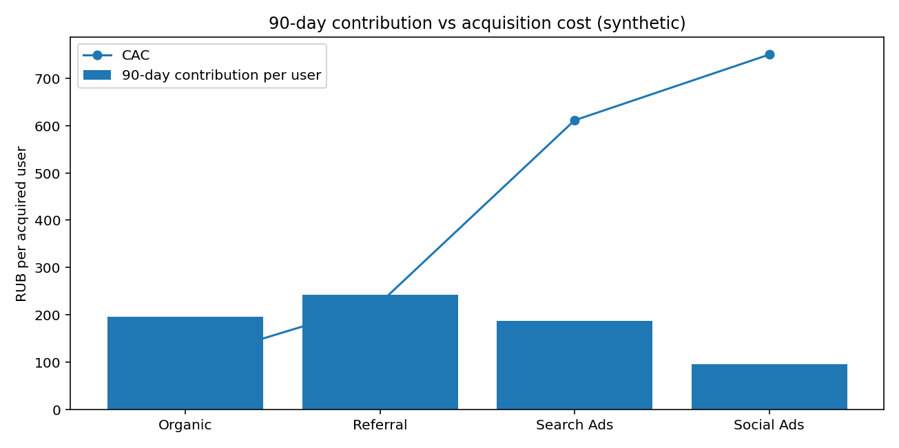
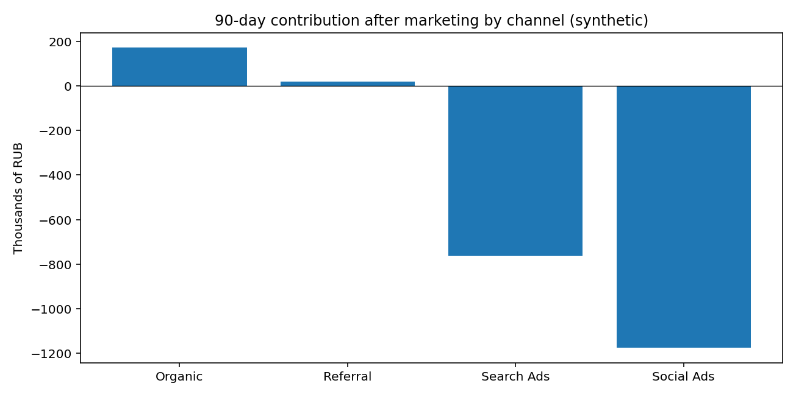

# Marketplace Unit Economics — CAC, 90-day contribution & channel profitability

  

> **Portfolio case (synthetic)**. All 6,600 users, 5,046 orders and marketing budgets are **generated**, not obtained from a real employer. Numbers are illustrative; no real commercial impact is claimed.

## Business question
A marketplace is spending money on growth. Which acquisition channels cover marketing cost through their **first 90 days of contribution**? Why can GMV grow while profitability deteriorates?

## Executive summary

| Channel | CAC (RUB) | 90-day contribution / acquired user (RUB) | Contribution / CAC |
|---|---:|---:|---:|
| Organic | 100 | 195.9 | 1.96 |
| Referral | 225 | 241.8 | 1.07 |
| Search Ads | 611 | 186.7 | 0.31 |
| Social Ads | 750 | 96.4 | 0.13 |

**Interpretation:** within this educational model, Organic and Referral cover their acquisition spend over 90 days; Search Ads and Social Ads do not. This is **not** full-company profit, nor a causal comparison of channels.





## Definitions and assumptions
- **Gross merchandise value (GMV)**: total value of fulfilled orders, excluding refunds. It is *not* marketplace revenue.
- **Marketplace revenue**: 15% take rate of fulfilled GMV + 35 RUB per fulfilled order.
- **Variable costs**: 2.2% of fulfilled GMV for payment processing, 65 RUB fulfilment + 12 RUB support per fulfilled order, and 45 RUB handling per refunded order.
- **Contribution**: marketplace revenue minus variable costs, before fixed costs and marketing.
- **CAC**: channel marketing spend / *all* acquired users (buyers and non-buyers).
- **LTV90 contribution proxy**: 90-day contribution / all acquired users. **Not lifetime LTV**.
- **Contribution/CAC ratio**: 90-day contribution / acquisition spend; above 1 means 90-day contribution covers acquisition spend in this model.
- **Contribution after marketing**: 90-day contribution - marketing spend, still *excluding* fixed costs, taxes and cost of capital.

## Files
- `data/`: three synthetic source tables: users, orders, marketing budgets.
- `src/generate_data.py`: deterministic synthetic data generation (random seed fixed).
- `src/analysis.py`: metrics, validation and plotting.
- `sql/analysis.sql`: SQLite analysis reconciled to Python results.
- `notebooks/walkthrough.ipynb`: notebook with narrative, calculations and plots.
- `figures/`: two ready-made charts.
- `reports/channel_economics.csv`, `reports/summary.json`: calculated metrics.
- `reports/findings.md`: business recommendations, assumptions and limitations.
- `tests/test_analysis.py`: automated checks.

## Reproduce locally
Python 3.10+:

```bash
python -m pip install -r requirements.txt
python src/generate_data.py
python src/analysis.py
python -m pytest -q
jupyter notebook
```

Open `notebooks/walkthrough.ipynb` and run cells from the repository root. All datasets can be regenerated using the fixed random seed. For SQL, import `data/*_synthetic.csv` to SQLite tables `users`, `orders`, `marketing` and execute `sql/analysis.sql`.

## Business caveats
Channel populations are **not randomly assigned**; apparent performance differences may come from user mix rather than channel causality. No incremental lift, true lifetime LTV, fixed overhead, taxation or financing costs were modeled. Marketing assumptions are demonstrative, not forecasts.

